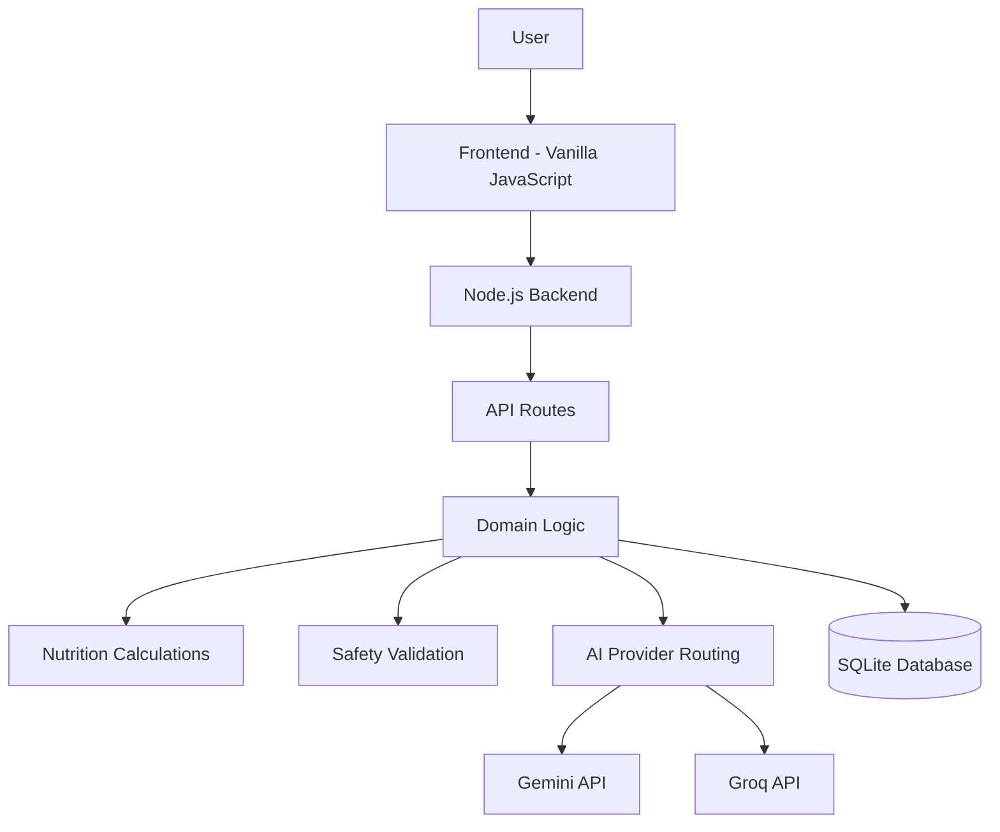
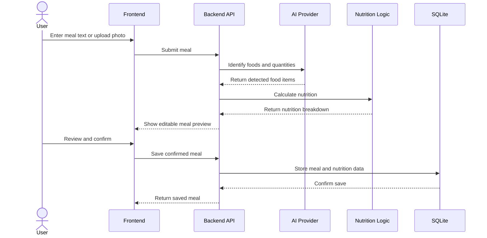
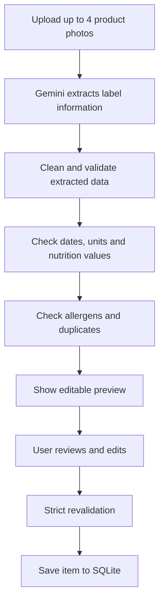
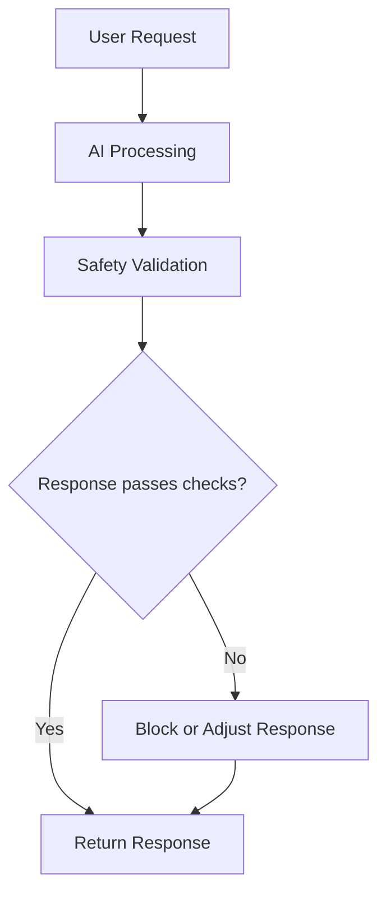

# NutriSense

A full-stack digital pantry and nutrition app that helps you manage food, track meals, understand your nutrition, and make informed food choices with AI-powered assistance.

## Features

| Feature | Description |
|---|---|
| **Digital Pantry** | Track pantry items, quantities, expiry dates, and nutritional information. |
| **Meal Logging** | Log meals using text or photos, review detected foods, and track calories and macros. |
| **Nutrition Insights** | View nutritional breakdowns, daily progress, and personalized insights. |
| **AI Diet Balancer** | Get suggestions to balance your meals based on your nutrition goals. |
| **AI Chat Assistant** | Ask food and nutrition-related questions with allergy-aware assistance. |
| **Recipe Suggestions** | Discover recipes based on available pantry ingredients. |
| **Weekly Meal Planner** | Plan meals and generate grocery lists. |
| **Pantry Scanner** | Scan product labels to extract item details, expiry dates, and nutrition information. |
| **Progress Tracking** | Monitor nutrition and meal patterns over time. |

## Architecture

NutriSense uses a browser-based frontend, a Node.js backend, SQLite for persistence, and external AI providers for selected tasks.



### Meal Logging Flow

Meal logging combines AI-assisted food identification with application-side nutrition calculations.



Known food nutrition values are calculated by the application using food quantities and stored nutritional data. AI-assisted identification does not directly determine the final nutritional calculations for known foods.

### Pantry Scanner Flow

The pantry scanner extracts information from product-label images and validates it before saving.



Uploaded photos are processed for extraction and are not stored as pantry images.

### Safety Workflow

AI-generated responses pass through application-level safety checks before being returned.



Safety checks include allergy-related restrictions, dietary preferences, and relevant nutrition guardrails.

## Key Engineering Highlights

- **Application-side nutrition calculations:** Known foods use stored nutritional values and quantities to calculate calories and macronutrients.
- **AI-assisted food identification:** Meal text and photos can be used to identify food items and estimate quantities.
- **Data validation:** Pantry scanner results are cleaned and validated before they can be saved.
- **Allergy-aware assistance:** Safety checks are applied to AI responses and relevant food suggestions.
- **AI provider fallback:** Gemini and Groq are used through a provider-routing layer with fallback support.
- **Structured data storage:** Pantry items, meals, and user information are persisted using SQLite.
- **No unnecessary dependencies:** The backend uses Node.js built-in capabilities, including `node:sqlite`.

## Tech Stack

| Layer | Technologies |
|---|---|
| Frontend | Vanilla JavaScript, HTML, CSS |
| Backend | Node.js |
| Database | SQLite (`node:sqlite`) |
| AI Providers | Google Gemini, Groq |
| Runtime | Node.js 22.13+ |

## Project Structure

```text
nutrisense2/
├── public/              # Frontend assets and application UI
├── server/
│   ├── routes/          # API route handlers
│   ├── lib/
│   │   ├── foods.js     # Food nutrition data
│   │   ├── nutrition.js # Nutrition calculations
│   │   ├── safety.js    # Safety validation
│   │   └── scan.js      # Pantry scan processing
│   └── test/            # Automated tests and evaluation
├── .env.example         # Environment variable template
├── package.json
└── README.md
```

## Getting Started

### Prerequisites

- Node.js 22.13 or later
- Gemini API key
- Groq API key

### 1. Clone the repository

```bash
git clone https://github.com/sahithi-kanjarla/nutrisense2.git
cd nutrisense2
```

### 2. Configure environment variables

Copy the example environment file:

```bash
cp .env.example .env
```

Add your API keys and other required environment variables to `.env`.

```env
GEMINI_API_KEY=your_gemini_api_key
GROQ_API_KEY=your_groq_api_key
```

### 3. Start the application

```bash
npm start
```

Open the local address printed by the server in your browser.

## AI Provider Routing

NutriSense uses both Gemini and Groq for AI-assisted features.

| Provider | Responsibilities |
|---|---|
| **Google Gemini** | Chat assistance, recipe suggestions, weekly meal plans, diet balancing, photo analysis, and weekly reviews. |
| **Groq** | Meal text analysis and estimates for new pantry items. |

The provider-routing layer supports fallback between the configured providers when a request cannot be completed by the primary provider.

## Testing

The project includes automated tests covering core application logic and important workflows, including:

- Nutrition calculations
- Meal logging and food matching
- Pantry scanning and validation
- Allergy and dietary safety checks
- AI response handling
- Application-level edge cases

## Notes

- NutriSense is a personal nutrition and food-management application, not a substitute for professional medical advice.
- Nutrition values and AI-generated estimates may not always be exact.
- Allergy-related checks are safeguards, not a guarantee against allergen exposure.
- Some AI features send relevant user-provided information to Gemini or Groq for processing.
