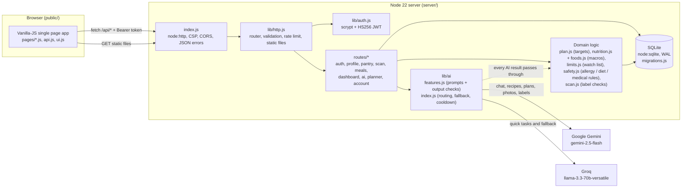
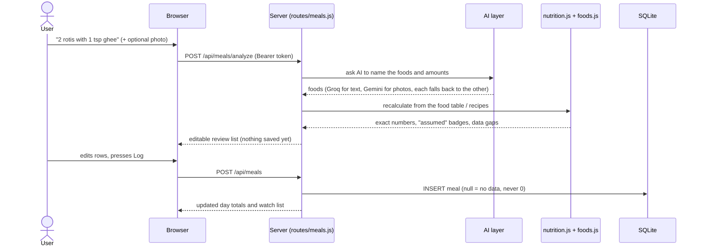

# NutriSense

A full-stack digital pantry and nutrition app: pantry with expiry tracking, meal logging with automatic macros, an AI diet balancer that suggests foods you already own, an allergy-aware AI assistant, recipes, a weekly planner with grocery list, a package-label scanner, and progress tracking.

Zero npm dependencies. It needs **Node 22.13 or newer** (uses the built-in `node:sqlite`).

## Features

| Area | What it does |
| --- | --- |
| Pantry | Items with quantity, location and expiry status (fresh, use soon, expired). **AI pantry scanner**: photograph a package (front, nutrition panel, ingredients, date) and review the extracted product before saving. |
| Meals | Describe a meal and/or attach a photo; foods are listed, editable and recalculated by the app before you log. Calories, macros, fibre, sodium, saturated fat and added sugar. |
| Diet balancer | Compares today's intake with your targets and suggests foods you already own. |
| Assistant and recipes | Allergy- and diet-aware chat, pantry-based recipes, saved recipes. |
| Planner | Weekly meal plan (manual or AI) and a grocery list built from it. |
| Progress | Weight, water, calories and watch-list trends; weekly AI review. |
| Account | Signup/login, data export (JSON), password change, account delete, throwaway demo account. |

## Architecture



**Request flow: logging a meal from text or a photo**



**Pantry scanner flow:** photos (up to 4) -> `POST /api/pantry/scan` -> Gemini reads the label -> `scan.js` cleans and validates it (dates, units, nutrition per 100 g, allergen conflicts with your profile, duplicate detection) -> you review and edit -> `POST /api/pantry/scan/confirm` re-validates strictly and saves. Photos are never stored, and nothing is saved without `confirmed: true`.

**Safety is enforced in code:** every AI reply passes through `lib/safety.js` (allergies, diet, crash-diet and medical rules) before it reaches the user.

## Project structure

```
nutrisense/
├── public/                 # Front end, served as static files (no build step)
│   ├── index.html
│   ├── css/app.css
│   └── js/
│       ├── app.js          # router, app shell
│       ├── api.js          # fetch wrapper + token storage
│       ├── ui.js           # html`` auto-escaping templates, modal, toast
│       ├── shared.js       # components shared between pages
│       └── pages/          # landing, auth, onboarding, dashboard, pantry, pantry-scan,
│                           # meals, recipes, assistant, planner, progress, profile, settings
├── server/
│   ├── index.js            # HTTP server, security headers, graceful shutdown
│   ├── routes/             # one file per area, each exports register(router)
│   ├── lib/
│   │   ├── ai/             # gemini.js, groq.js, index.js (routing), features.js (prompts + checks)
│   │   ├── auth.js         # password hashing, JWT
│   │   ├── db.js           # schema + tiny query helper;  migrations.js = versioned upgrades
│   │   ├── env.js          # .env loading and config
│   │   ├── http.js         # router, body parsing, validation, rate limiting, static files
│   │   ├── plan.js         # calorie / macro / water targets
│   │   ├── nutrition.js, foods.js, food-nutrients.js   # food table and calculation
│   │   ├── limits.js       # sodium / saturated fat / added sugar limits
│   │   ├── safety.js       # allergy, diet and medical safety checks
│   │   └── scan.js         # label cleaning, per-100 g conversion, duplicates
│   └── test/               # unit.test.js, api.test.js (mock AI servers, in-memory DB)
├── Dockerfile, .env.example
└── package.json
```

## Setup

```bash
cp .env.example .env      # then edit .env
npm start                 # http://localhost:4000
```

Put your keys in `.env`:

| Variable | Purpose |
| --- | --- |
| `GEMINI_API_KEY` | Google AI Studio key (free tier). Primary AI. |
| `GROQ_API_KEY` | Groq key. Used for light tasks and as a fallback. |
| `JWT_SECRET` | Optional. A random secret is generated and saved if empty. |
| `GEMINI_MODEL`, `GROQ_MODEL` | Optional. Default `gemini-2.5-flash` and `llama-3.3-70b-versatile`. |
| `GROQ_JSON_SCHEMA` | Optional. `true` asks Groq to enforce a JSON schema (falls back automatically if refused). |
| `PORT`, `DATABASE_PATH` | Optional. Defaults: 4000 and `./server/data/nutrisense.db`. |
| `HOST` | Optional. Default `127.0.0.1` (this machine only). Use `0.0.0.0` on a hosting platform. |
| `TRUST_PROXY` | Set `true` behind a reverse proxy (Render, Railway, Fly, nginx) so rate limits use the real client IP from `X-Forwarded-For`. Leave unset when the server is exposed directly, or clients could fake their address. |
| `CLIENT_ORIGIN` | Optional. Only if a separate website calls this API (turns on CORS for that origin). |

The app works without keys: sign-up, pantry, meal logging (built-in food table of ~110 foods), the pantry-based balancer and the planner all run offline. Chat, recipes, photo analysis and AI planning need a key and show a clear "add your key" message otherwise.

## How the AI is routed

- **Gemini** (`gemini-2.5-flash`): chat, recipes, weekly plans, balancer wording, photo analysis, weekly review.
- **Groq** (`llama-3.3-70b-versatile`): quick tasks (meal text analysis, nutrition estimates for new pantry items), saving Gemini's free quota.
- Each falls back to the other on errors or rate limits (with a short cooldown).

Safety is enforced in code, not only in prompts: AI recipes (title, ingredients, steps), weekly plans, chat replies, balancer suggestions and review text are checked against the user's allergies and diet. Unsafe recipes are retried once, then dropped, and unsafe prose is replaced with a safe message. The checks understand plurals and common Indian food names, but they are keyword based, so treat them as a strong safety net rather than a guarantee. Calorie targets use Mifflin-St Jeor with floors, no deficit for under-18s, low BMI or pregnancy.

## How nutrition is calculated

- **Daily targets** use the Mifflin-St Jeor equation with safety floors. No AI is involved.
- **Foods in the built-in table** are calculated exactly: `amount in grams x values per 100 g`. Portion words are converted with food-specific weights (a teaspoon of ghee is 4.5 g, of sugar 4.2 g, a katori of dal about 150 g, a roti 40 g). Oil is stored per 100 ml (it weighs 0.92 g/ml).
- **Cooked dishes** such as roti, dal, idli, dosa, poha, upma, khichdi and pulao are *calculated from ingredient quantities* (for example one 40 g roti = 30 g atta + 1.5 g ghee), not typed in as one number.
- **Cooking notes** change the result: an explicit amount ("1 tsp ghee"), a level ("very little oil", "deep fried", "no oil") and a flour blend ("oats flour and wheat flour", "70% wheat 30% oats"). When proportions are not given, equal parts are assumed and the result says so. Other details in a note (spices, gravy base) are kept as text and do not change the calories; the result says that too.
- **The AI names the foods; the app does the arithmetic.** When the AI recognises a food in the table and gives an amount, the numbers are recalculated from the table or recipe (including your cooking note and any flours in the food name), and the AI's own figure is kept for comparison. A weight in the text, such as "(150 g)", wins over wording like "1 bowl".
- **Foods the table does not know** are estimated by the AI. Its numbers are checked: calories above 9 kcal per gram are impossible and are lowered, nutrients that outweigh the food are scaled down, and an estimate far from the built-in table is flagged "Check" with the table's figure.
- **Data sources.** Each table entry has a source: `usda-checked` (compared with USDA FoodData Central and within a few percent: rice, cooked rice, atta, oats, maida, besan, toor, moong and masoor dal), `calculated` (cooked dishes built from ingredients), or `reference` (typical IFCT or USDA values entered by hand, not individually verified). Treat everything as an estimate: real portions, brands and recipes vary by 10 to 25 percent.

## Sodium, saturated fat and added sugar

These three are tracked next to calories and macros, with a **Watch list** on the dashboard, the meal log and Progress.

- **Missing data is not zero.** Each food has a figure or "no data" (`null`). A food with no reliable figure (for example protein powder) is never counted as 0. Totals add up only the foods and meals that have data and are worded **"At least X"** when some do not ("At least 1,450 mg, 2 of 3 meals have full data"). A total that is under the limit but incomplete shows **May be higher**, not a green tick; a total that is already over the limit says so even when data is missing, because the real figure can only be higher. Old meals logged before this feature have no data and are left out of these totals.
- **Where the numbers come from.** Raw foods, fruit, vegetables and nuts use typical USDA and IFCT values. Cooked dishes in the recipe table are calculated from their ingredients plus salt (about 0.8% of the dish by weight, none for millet rotis). Other prepared and packaged foods use typical Indian values and vary by brand. All of these are `reference` values entered by hand: they are not individually verified against USDA, so treat them as estimates. Plain foods such as rice are listed without added salt.
- **Added sugar means free sugars** (WHO): table sugar, jaggery, honey, syrups and the sugars in juices. Sugar inside whole fruit, vegetables and milk is not counted.
- **Salt in cooking notes.** "no salt", "low salt" (half the usual), "extra salt" (1.5 times), or an amount ("1/2 tsp salt", "a pinch of salt", "1 tsp extra salt") change the sodium of recipe dishes. Salt added at the table, and dishes the app cannot look up, are not counted, so sodium is a floor and the real intake can be higher.
- **AI estimates are checked.** Foods the table does not know can come back with these values from the AI. Missing or invalid values become "no data", saturated fat is capped at total fat, added sugar at total carbs, and a sodium figure that is more than pure salt for that amount is discarded.
- **Daily limits** are ceilings to stay under, not goals. They follow age and conditions, and the stricter limit wins: sodium under 2,000 mg (WHO; 1,800 mg at age 13; 1,500 mg with high blood pressure), saturated fat under 10% of calories (6% with high cholesterol), added sugar under 10% of calories (5% with type 2 diabetes or PCOS, at most 25 g under 18). They are general guidance, not medical advice. People with kidney disease or heart failure need limits set by their doctor: see "Safety rules" below.
- **Database upgrade.** The first start after updating adds four columns to `meals` (`sodium_mg`, `added_sugar`, `sat_fat`, `nutrient_gaps`) and sets `PRAGMA user_version = 1`. Existing rows are kept and get no data. Before changing an existing database file, a copy is saved next to it as `nutrisense.db.before-v1`. To undo the upgrade, stop the server and put that copy back.

## Safety rules

NutriSense gives general nutrition guidance. It is not medical advice and it has not been clinically validated. These rules keep it from making harmful suggestions. A dietitian should review them before real users rely on them.

- **Allergies and diet are hard rules.** Every AI reply, recipe (title, ingredients and method), balancer suggestion and weekly review is checked in code, not only in the prompt. The check knows plurals, common Hindi and regional names, hidden ingredients (mayo, hummus, Worcestershire, soy sauce, naan), look-alikes that are fine (goat milk is dairy but not meat, veggie burger is vegetarian) and "no X" or "X-free" in AI text. A food name that says "gluten-free" is still blocked for a gluten allergy. A free-text allergy such as "milk allergy" or "lactose" is matched to its food group. If one cannot be matched it is matched as typed, and the profile page says so.
- **Unsafe advice is blocked, not just discouraged.** Crash diets, detoxes, prolonged fasts and skipping meals are blocked for everyone. With a doctor-managed condition, extra protein, protein supplements, salt substitutes, potassium or electrolyte products, and "drink more water" are blocked. In pregnancy, alcohol and raw or unpasteurised foods are blocked. Advice that warns against these things ("never skip meals") is allowed. A blocked reply is replaced, and a blocked recipe is regenerated once and then dropped.
- **Worrying chat messages never reach the AI.** Messages about eating very little (under 1,000 kcal a day), purging, starving or losing weight very quickly get a fixed, caring reply that points to a doctor, dietitian or counsellor (in India, Tele-MANAS 14416).
- **Targets.** Calorie floors are 1,200 (female), 1,500 (male), 1,350 (not stated) and 1,400 under 18. They are conventional floors, not clinical limits. Under 18s, pregnancy and doctor-managed conditions never get a deficit, and hand-set targets cannot go below about maintenance. Hand-set macros must add up to the calories within 10%, fat must be at least 15% of calories, and protein must be between 0.6 and 3 g per kg. A "lose" or "gain" goal needs a target weight in the same direction, or calories stay at maintenance. A target weight below BMI 18.5 is raised to BMI 18.5 before it is saved. Water is about 30 ml per kg, kept between 1.5 and 3 litres, and a hand-set value is at most 16 glasses.
- **Pregnancy.** Pick a stage in the profile. Extra calories are 0 in the first trimester, 340 in the second, 450 in the third and 330 while breastfeeding, with protein of 1.1 g per kg (1.3 while breastfeeding). They are US Institute of Medicine average figures, not a prescription. With no stage chosen, nothing extra is added. There is never a calorie deficit in pregnancy.
- **Kidney disease, heart failure or another doctor-managed condition.** The right limits depend on the person, so the app never invents them. Users can enter the daily sodium, protein and fluid limits their care team gave them. Without them the app uses a general sodium ceiling of 2,000 mg (KDIGO advises under 2 g for kidney disease) and the general adult protein figure of 0.8 g per kg, shown as a ceiling and labelled as not a prescription. A number the user entered always replaces the default. There is no water target or hydration reminder, no "high protein" recipe filter, and protein is never treated as a gap to fill. Recipes must fit within 40% of the sodium ceiling and half of the protein ceiling per serving. The AI's sodium figure is an estimate, and a recipe without one is shown as "sodium not verified". Potassium and phosphorus are not tracked, and the AI is told never to call a food safe for the kidneys or heart.
- **BMI** is shown on the WHO scale and the South Asian scale (overweight from 23, obese from 25), only for ages 19 and over, and always as a screening number and not a diagnosis. Weight-goal timelines are shown as "about N weeks or more", because the 7,700 kcal per kg rule overestimates how fast weight changes.
- **Database upgrade.** The profile table gains `preg_stage`, `rx_sodium_mg`, `rx_protein_g` and `rx_fluid_ml` (schema version 2). Existing users keep their targets, and a `.before-v2` backup of the database file is written before the change. To undo it, stop the app and copy the backup over `nutrisense.db`.

## Meal logging and review

Describe a meal, attach a photo, or do both. NutriSense lists the foods it found, and nothing is saved until you press **Log**.

- Every food row is editable (name, amount, ingredients and cooking), and you can remove wrong detections or add missing foods. Edited rows must be recalculated before logging.
- Badges show where each row came from: **You said**, **Seen in photo**, or **Assumed** (an AI guess). A photo cannot show hidden ingredients, oil, ghee or exact weights, so those are always labelled as assumptions.
- The AI may ask up to three quick follow-up questions (for example how much oil was used). You can skip them.
- Photos are analysed once and are not stored. Photo analysis needs a Gemini key.
- Manual entry is unchanged.

## Pantry scanner

Photograph a package (front, nutrition panel, ingredients list, expiry date; up to four photos). **Needs a Gemini key.**

- The AI only reads the label. The app then cleans and checks it: dates (flagging ambiguous ones such as 03/04), units, nutrition converted to per 100 g or 100 ml, allergens against your profile, and likely duplicates already in your pantry.
- You review and edit everything. Nothing is saved until you confirm, and the server validates the payload again as strictly as any form.
- Missing label values stay empty, never zero. Photos are analysed once and are not stored.
- **Database upgrade (schema version 3):** `pantry_items` gains `brand`, `category`, `ingredients`, `allergens`, `sodium100`, `sugar100`, `sat_fat100`, `expiry_kind`, `expiry_text`, `mfg_on`, `label_nutrition` and `source`. A `.before-v3` backup is written first.

## Demo

On the login page, **Try the demo** creates a temporary guest account with sample meals, pantry and weight history (removed after 3 days). Please do not enter real health details in a public demo.

## API overview

All routes are under `/api`. Everything except the ones marked public needs `Authorization: Bearer <token>`. Errors are `{ "error": "...", "code": "..." }`.

| Area | Endpoints |
| --- | --- |
| Public | `GET /health`, `GET /ai/status`, `POST /auth/signup`, `POST /auth/login`, `POST /auth/demo` |
| Session and account | `GET /auth/me`, `PUT /settings`, `POST /account/password`, `GET /account/export`, `DELETE /account` |
| Profile | `GET /profile`, `PUT /profile`, `PUT /targets`, `POST /profile/reset`, `POST /onboarding`, `POST /plan/preview`, `GET /meta` |
| Pantry | `GET/POST /pantry`, `PATCH/DELETE /pantry/:id`, `POST /pantry/scan`, `POST /pantry/scan/confirm` |
| Meals | `GET/POST /meals`, `DELETE /meals/:id`, `POST /meals/analyze`, `/meals/analyze-photo`, `/meals/estimate-items` |
| Dashboard | `GET /dashboard`, `GET /progress`, `GET/PUT /water`, `POST /weight` |
| AI | `POST /ai/balance`, `GET/POST/DELETE /ai/chat`, `POST /ai/recipes`, `/ai/plan-week`, `/ai/review` |
| Planner | `GET /planner`, `PUT /planner/meal`, `DELETE /planner/meal/:id`, grocery: `GET/POST /grocery`, `PATCH/DELETE /grocery/:id`, `POST /grocery/clear-checked`, `POST /grocery/from-plan` |
| Recipes | `GET/POST /recipes/saved`, `DELETE /recipes/saved/:id` |

Rate limits: signup 20 per hour per IP, login 10 per 15 minutes per IP and email, demo 10 per hour per IP, AI calls 30 per minute per user, scans 10 per minute per user.

## Deploying

NutriSense is a single Node process with a SQLite file, so it runs on one instance with a **persistent disk**. Do not run several copies against one database.

### Docker

```bash
docker build -t nutrisense .
docker run -d -p 4000:4000 -v nutrisense-data:/data \
  -e GEMINI_API_KEY=... -e GROQ_API_KEY=... -e JWT_SECRET=$(openssl rand -hex 32) \
  nutrisense
```

The image listens on `0.0.0.0:4000`, keeps the database in the `/data` volume and has a health check on `/api/health`.

### Render, Railway, Fly.io or any Node host

1. Node 22.13 or newer; build command none; start command `npm start`.
2. Environment variables (not the `.env` file): `GEMINI_API_KEY`, `GROQ_API_KEY`, `JWT_SECRET` (a long random string), `HOST=0.0.0.0`, `TRUST_PROXY=true`, and `DATABASE_PATH` pointing into the persistent disk (for example `/data/nutrisense.db`).
3. Attach a persistent disk or volume at that path. Without one, every redeploy wipes users and data.
4. Health check path: `/api/health`. Terminate HTTPS at the platform (the server speaks plain HTTP).

### Backups

Copy the database while the app runs with `sqlite3 nutrisense.db ".backup backup.db"`, or snapshot the volume. Keep `.db-wal` with the file if you copy it by hand.

### Before real users rely on it

- [ ] Have a dietitian review the rules in "Safety rules" (this app is not clinically validated).
- [ ] Add a privacy notice: profile, pantry and photos are sent to Google (Gemini) and Groq when AI features are used.
- [ ] Set a strong `JWT_SECRET`; set `TRUST_PROXY=true` only behind a proxy you control.
- [ ] Schedule database backups and test a restore.
- [ ] Remember tokens last 30 days and live in the browser's localStorage; changing a password does not sign out other devices yet.

## Commands

```bash
npm start     # run the server
npm run dev   # run with auto-restart
npm test      # unit and API tests (mock AI servers, in-memory DB)
```

## Notes and limits

- Profile and pantry details are sent to Gemini/Groq when you use an AI feature.
- Only sodium is tracked among minerals (no potassium, iron, calcium or vitamins) and there is no barcode scanning yet. Progress shows only what is actually tracked.
- The units and reminder settings are saved, but display is metric/kcal and reminders are not delivered (no notification service).
- General nutrition guidance, not medical advice.
